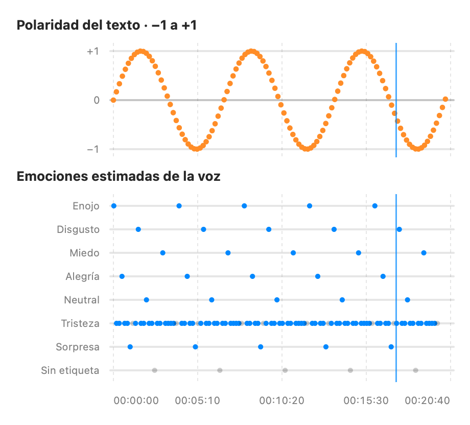

<div align="center">
  
  <h1>PAIMON</h1>
  <p><strong>Transcribe el audio de tu Mac y vuelve a lo que se dijo.</strong></p>
  <p>Resume la sesión, explora el texto y la voz, y obtén respuestas con citas a la transcripción.</p>
  <p>
    
    
    
  </p>
  <p><a href="https://github.com/AD0441/PAIMON/releases/download/v0.12.1/PAIMON-0.12.1.zip"><strong>Descargar PAIMON 0.12.1</strong></a> · <a href="#descargar-instalar-y-ejecutar">Instalación</a> · <a href="#qué-nos-diferencia">Funciones</a> · <a href="#compilar-desde-el-código-fuente">Código fuente</a></p>
</div>

## Qué nos diferencia

PAIMON captura lo que ya suena en el Mac o transcribe una grabación que ya tienes. Sobre **una misma transcripción**, puedes preparar el acta de una reunión, comparar la polaridad del texto con lo que se estimó de la voz o preguntar quién quedó a cargo de una tarea. Con los modelos preparados, las tres funciones trabajan **en el Mac, sin conexión, clave API ni telemetría**.

| Vista | Qué puedes hacer |
| --- | --- |
| **Resumen local** | Reúne ideas, acuerdos, tareas y preguntas abiertas en un informe con citas. [Ver el resumen](#resumen-local) |
| **Sentimientos** | Revisa el tono del texto, busca sonidos como risas o aplausos y compara texto y voz en una misma línea de tiempo. [Ver el análisis](#sentimientos-de-la-transcripción) |
| **Asistente local** | Haz preguntas sobre lo conversado, sigue preguntando y abre el fragmento que respalda la respuesta. [Ver el Asistente](#asistente-local-de-la-transcripción) |


*Ilustración promocional generada con IA. Las capturas de la aplicación que aparecen más abajo corresponden a sesiones sintéticas.* [Procedencia de la portada](docs/assets/promo/photographic-cover.md).

## Descargar, instalar y ejecutar

1. Descarga el ZIP de **PAIMON 0.12.1** en un **Mac con Apple Silicon y macOS 26 o posterior**. [Descargar ZIP](https://github.com/AD0441/PAIMON/releases/download/v0.12.1/PAIMON-0.12.1.zip).
2. Descomprime el archivo y arrastra **PAIMON.app** a **Aplicaciones**. Si ya tienes PAIMON, ciérralo antes de reemplazar la app. El historial se conserva en el almacenamiento local.
3. Abre PAIMON. En **Ajustes → Inteligencia**, elige español o inglés y pulsa **Comprobar disponibilidad**. Si faltan recursos de voz, ve a **Ajustes → Modelos** y pulsa **Autorizar descarga del idioma seleccionado**. Activa **Apple Intelligence** desde Ajustes del Sistema para usar el resumen de Apple, el Asistente y las etiquetas de emoción.
4. Pulsa **Importar audio** para empezar con una grabación, o selecciona **Todo el sistema** o una aplicación abierta y pulsa **Iniciar**. Para capturar, concede el permiso de audio del sistema en macOS. Si activas el micrófono, concede también su permiso.
5. Pulsa **Detener** al terminar la captura y abre **Resumen**, **Sentimientos** o **Asistente**. Para analizar el tono, pulsa **Analizar sentimientos**. Para consultar la sesión, escribe una pregunta y pulsa **Preguntar**.

La descarga tiene firma ad hoc. La notarización y las pruebas de instalación en otros Mac siguen pendientes. La compilación 28 se verificó en un M1 de 8 GB con macOS 27.3. [Historial de versiones](https://github.com/AD0441/PAIMON/releases) · [Alcance de las pruebas](docs/VALIDATION.md#alineación-de-la-vista-mixto--paimon-0121-28).

<details>
<summary>Verificar la descarga con SHA-256</summary>

Guarda el archivo de verificación en la misma carpeta que el ZIP y ejecuta el comando desde esa carpeta. [Descargar SHA-256](https://github.com/AD0441/PAIMON/releases/download/v0.12.1/PAIMON-0.12.1.zip.sha256).

```bash
shasum -a 256 -c PAIMON-0.12.1.zip.sha256
```

</details>

## De escuchar a entender

**Captura el audio del sistema o de una aplicación sin dispositivos virtuales y sin silenciar la reproducción.** Añade el micrófono si quieres registrar tu intervención. Puedes iniciar, pausar, reanudar o detener una sesión desde la barra de menús, y añadir un marcador mientras escuchas.

Si ya tienes el audio, usa **Importar audio** o arrastra un archivo WAV, M4A, AIFF o MP3. La importación trabaja por bloques y conserva el archivo original. Para grabaciones con volumen desigual, puedes activar **Normalizar volumen y comprimir picos** en **Ajustes → Audio y memoria**.

## Resumen local

**Revisa qué se decidió y qué queda pendiente.** PAIMON reúne el tema, los puntos clave, los acuerdos, las tareas y las preguntas abiertas que encuentra en la transcripción. Cambia entre **Ejecutiva**, **Completa** y **Acuerdos y pendientes** para revisar la misma sesión con distintos niveles de detalle.


El resumen se actualiza durante la captura y prepara una síntesis al detenerla. Elige una plantilla de **Reunión**, **Clase** o **Video o podcast** para orientar el informe. Puedes añadir el objetivo de la sesión, su temario o términos que quieras conservar.

<details>
<summary>Ver cómo una cita abre su fragmento</summary>

Abre el icono de evidencia junto al hallazgo para revisar la cita y saltar al texto correspondiente. Si la sesión viene de un archivo importado y el original sigue disponible, también puedes escuchar el intervalo.


</details>

**Copia el informe con formato para Word o Pages**, o expórtalo en **TXT, Markdown, PDF o JSON**. Markdown y PDF conservan los encabezados y el énfasis. Puedes añadir un anexo de citas e incluir los marcadores y las notas. JSON conserva los hallazgos y sus referencias para usarlos en otras herramientas.

## Sentimientos de la transcripción

Abre **Sentimientos** y pulsa **Analizar sentimientos**. El gráfico te permite localizar dónde cambió el tono del texto. Cada punto corresponde a un fragmento. **−1** es el extremo negativo, **0** es neutro y **+1** es el extremo positivo. Si muchos puntajes coinciden en un extremo, PAIMON muestra cuántos fragmentos recibieron ese valor.


Las etiquetas de emoción describen expresiones del lenguaje. Por ejemplo, **preocupación** marca un pasaje que expresa inquietud. Pulsa una etiqueta o un punto para revisar su contexto. En los cambios destacados puedes comparar el puntaje anterior con el actual.

### Voz y vista Mixto

En **Sentimientos → Voz**, revisa intensidad, altura tonal y pausas. Elige qué sonidos quieres detectar en **Ajustes → Modelos → Análisis vocal → Sonidos por detectar**. Puedes buscar risas, aplausos y otras categorías del catálogo de Apple.

En **Mixto**, compara la polaridad de la transcripción con las etiquetas experimentales que estima emotion2vec+. Los dos gráficos comparten escala y cursor. Pulsa un punto para volver al fragmento o escuchar el intervalo si el audio está disponible.



*Vista Mixto con datos sintéticos.* La voz se analiza si conservas el audio o puedes vincular el original. El modelo opcional de voz se descarga, activa o borra desde **Ajustes → Modelos → Emociones de voz**. Sus etiquetas son estimaciones del modelo y no determinan cómo se siente una persona.

## Asistente local de la transcripción

Abre **Asistente** y pregunta, por ejemplo, **«¿Quién enviará la cotización y cuándo?»**. Puedes seguir preguntando sobre esa sesión. Pulsa una cita con su hora para volver al fragmento original. Si los pasajes consultados no respaldan una respuesta, PAIMON te lo indica.


El Asistente usa Apple Intelligence en el Mac. En sesiones largas consulta una selección de pasajes relevantes. La conversación se mantiene en memoria mientras la sesión está seleccionada. Las consultas se pausan durante la captura, la importación o la presión de memoria.

## Trabaja con tus sesiones

- **Encuentra una frase.** Busca dentro de una sesión o en todo el historial con **⌘⇧F**. Cada resultado de la búsqueda global te lleva al fragmento. Las marcas de tiempo ayudan a ubicar el pasaje en la grabación.
- **Corrige y marca.** Edita el texto reconocido o restaura el original sin cambiar sus tiempos. Usa **⌘⇧M** para marcar un momento y añadir una nota.
- **Separa voces.** Instala los recursos de diarización desde **Ajustes → Modelos** y activa **Separar voces** antes de capturar o importar. Puedes poner un nombre a las voces que PAIMON logra distinguir. [Requisitos de la diarización](docs/DEPENDENCIES.md#diarización-local-opcional).
- **Conserva o elimina el historial.** Las sesiones, transcripciones, informes y notas se guardan en el Mac. El audio de captura se guarda solo si activas **Guardar audio de próximas sesiones**. Eliminar una sesión retira sus datos y grabaciones de PAIMON. Tus originales y exportaciones se administran por separado.

## Procesamiento local y opciones de configuración

**Apple SpeechTranscriber** transcribe en español o inglés según el idioma que selecciones. El motor de **Apple Foundation Models** genera el resumen. Apple Intelligence también se usa para el Asistente y las etiquetas de emoción. La disponibilidad de la polaridad depende de los idiomas que ofrece NaturalLanguage en tu Mac.

En **Ajustes → Modelos** puedes preparar alternativas locales. **Parakeet Redux** transcribe audio multilingüe y **MLX con Qwen 1.5B** genera resúmenes. Las descargas se inician al solicitarlas y se pueden borrar desde la app. [Motores, tamaños y preparación](docs/DEPENDENCIES.md).

<details>
<summary>Proveedor externo de resumen opcional</summary>

Google AI (Gemini) está desactivado por defecto. Si decides usarlo, guarda tu propia clave en **Ajustes → Google AI**, en el Llavero de macOS, y selecciona ese motor para la sesión que quieres resumir. El proveedor recibe fragmentos de texto, contexto y resúmenes previos por Internet. La captura, el reconocimiento de voz, el análisis de sentimientos y el Asistente siguen ejecutándose en el Mac. [Configuración y requisitos del proveedor](docs/DEPENDENCIES.md#google-ai-opcional--sin-sdk-externo).

</details>

## Compilar desde el código fuente

Abre `LocalAudioIntelligence.xcodeproj` y selecciona el esquema **LocalAudioIntelligence** con destino **My Mac**. La compilación publicada se preparó con Xcode 27.2, SDK macOS 27.2 y Swift 6.4, con destino mínimo macOS 26.0 y arquitectura arm64.

```bash
./script/build_and_run.sh            # compilar y abrir
./script/build_and_run.sh --install  # instalar en Aplicaciones
./script/test.sh                     # ejecutar las pruebas
```

La compilación 28 pasó la suite disponible. Se comprobó con datos sintéticos que los dos gráficos de Mixto mantienen el cursor alineado y sus etiquetas separadas en tres anchos de ventana. [Resultados y cómo repetirlos](docs/VALIDATION.md#alineación-de-la-vista-mixto--paimon-0121-28).

- [Requisitos y estado](docs/REQUIREMENTS.md) · [Limitaciones](docs/LIMITATIONS.md)
- [Arquitectura y privacidad](docs/ARCHITECTURE.md) · [Mediciones en Apple Silicon](docs/PERFORMANCE.md)

## Apariencia y proyecto

PAIMON ofrece interfaz en **español e inglés** y cuatro paletas en **Ajustes → Apariencia**. El modo claro u oscuro sigue la configuración de macOS.

<details>
<summary>Ver las paletas de PAIMON</summary>


</details>

<div align="center">
  <p><strong>Creado por Sebastián Pastén F.</strong></p>
  <p><a href="docs/BRAND.md">Identidad de PAIMON</a> · <a href="docs/FAMILY.md">Familia de aplicaciones</a> · <a href="https://www.sebastianpasten.com/desarrollos-aplicaciones-para-mac-software-sdr">Más aplicaciones para Mac</a></p>
  <p><a href="https://ko-fi.com/C0C51WQ1T0"></a></p>
</div>
