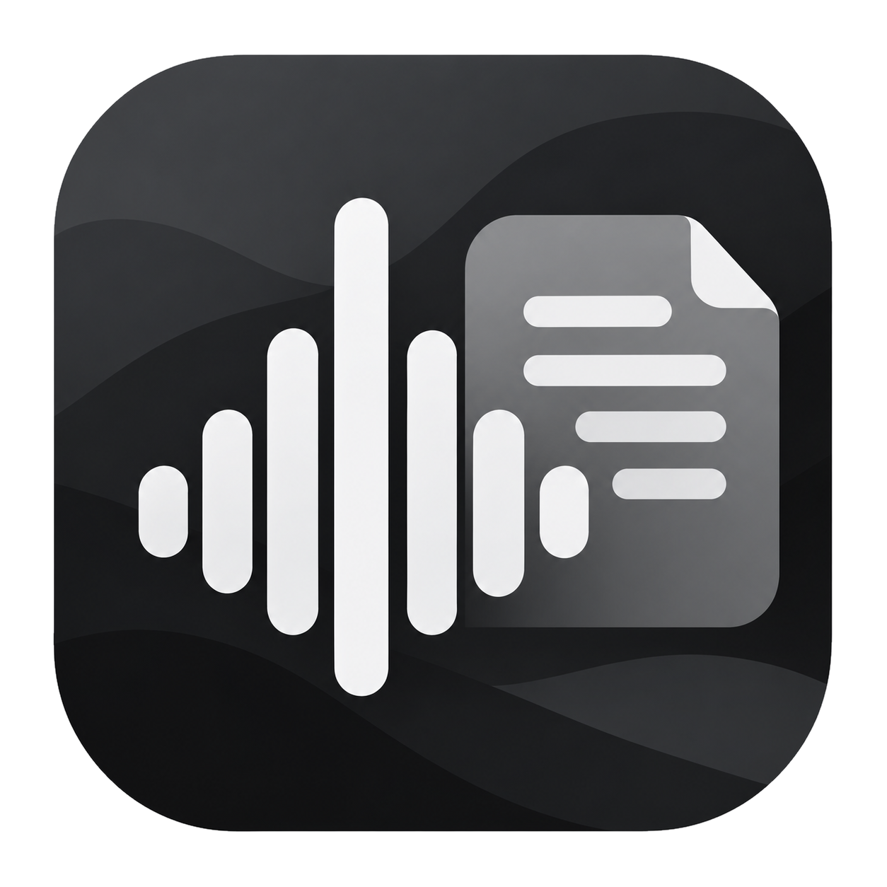
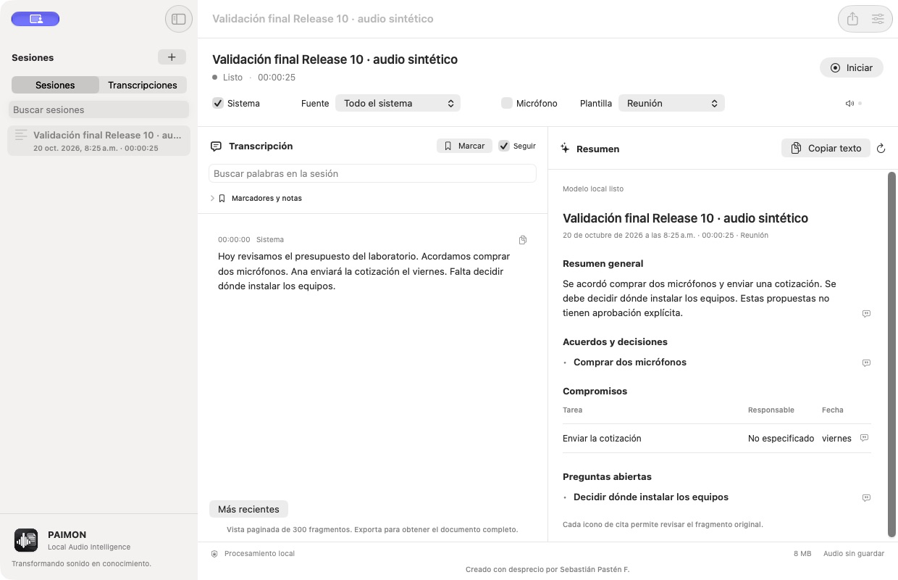
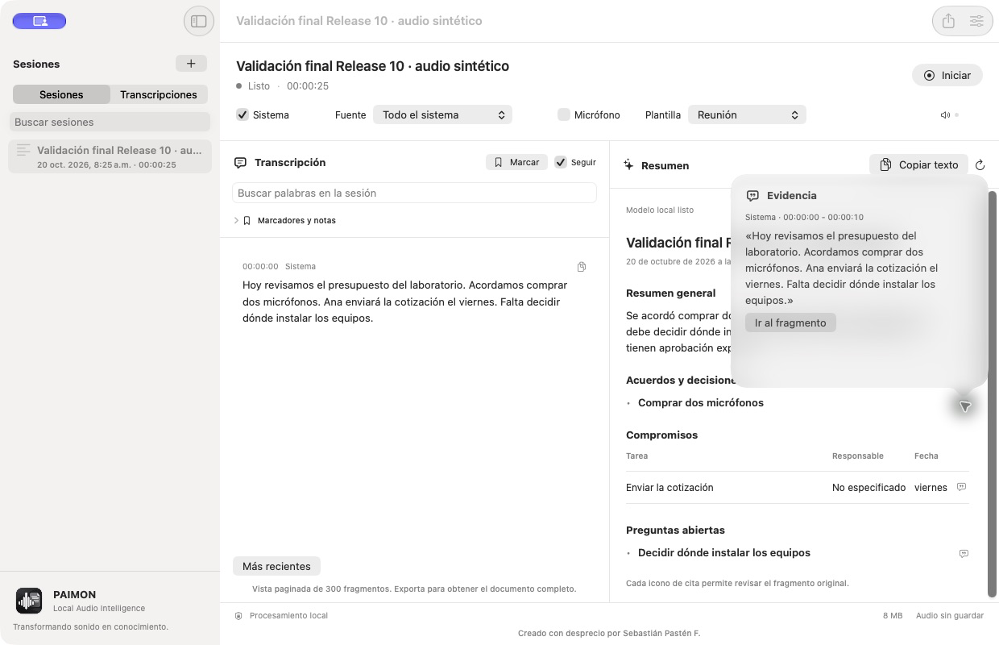

# PAIMON



**Local Audio Intelligence**  
Transformando sonido en conocimiento.

Aplicación nativa para Apple Silicon y macOS 26+, SwiftUI, Swift 6 y procesamiento local. Captura de sistema con Core Audio Process Taps sin dispositivos virtuales, micrófono opcional, SpeechAnalyzer, Foundation Models, historial SQLite y exportación TXT/Markdown/PDF/JSON. No incluye telemetría ni clientes de IA remotos.



Captura real de la aplicación instalada con una muestra de voz sintética local. No contiene conversaciones del usuario. El texto original permanece separado del resumen y cada icono de cita abre su evidencia.

<details>
<summary>Ver cómo se comprueba una cita</summary>



</details>

## Estado de la versión

**0.4.0 (10), en validación.** 55 pruebas automáticas aprobadas. Captura, transcripción, pausa, reanudación, detención y exportación comprobadas en un Apple M1 con 8 GB y macOS 27.2. El deployment target es macOS 26.0; falta probar ese sistema y sesiones reales de varias horas. El resumen final aplazado por presión de memoria se recuperó posteriormente y se comprobó en la interfaz. Consulta los [resultados y su alcance](docs/VALIDATION.md).

La copia ejecutable se distribuye como ZIP en [Releases](https://github.com/AD0441/PAIMON/releases). Es una compilación local con firma ad hoc, sin notarización Developer ID; no equivale a una distribución firmada para todos los Mac. Los modelos opcionales no están incluidos. El repositorio contiene el código, el proyecto Xcode, las pruebas y la documentación; las sesiones, grabaciones y credenciales permanecen fuera de Git.

## Abrir y ejecutar

La aplicación instalada está en **/Applications/PAIMON.app**. Se abre desde Finder → Aplicaciones o buscando PAIMON en Spotlight. No necesita abrir Xcode. La firma «Creado con desprecio por Sebastián Pastén F.» aparece al pie de la ventana. El historial permanece en el almacenamiento local del usuario al actualizar la aplicación.

Junto a `LocalAudioIntelligence.xcodeproj` y al código fuente están **PAIMON.app** y **PAIMON-0.4.0.zip**. En esta carpeta sincronizada, PAIMON.app es un enlace a la aplicación instalada: File Provider añadía FinderInfo al bundle físico e invalidaba su firma. El ZIP conserva una copia completa y portátil; el instalador la extrae temporalmente y verifica su firma. `./script/build_and_run.sh --install` actualiza la aplicación, el acceso del proyecto y el ZIP de la versión. Para llevar la app a otro Mac, usa el ZIP.

El icono original entregado por el usuario se conserva en `Resources/Brand/Sinora_icono.png`. `Resources/Paimon.icns` contiene sus tamaños estándar para macOS, generado con `./script/rebuild_icon.sh` mediante `sips` e `iconutil`, sin modificar el original. Xcode lo incluye como recurso del bundle. El nombre del proyecto y del esquema se mantiene por compatibilidad con las herramientas; el producto compilado es **PAIMON.app**.

El cambio de nombre conserva el identificador `local.audio.intelligence`, las preferencias y la carpeta local de datos. Al instalar, las aplicaciones del nombre anterior se mueven a una carpeta temporal de respaldo indicada por el script, después de verificar la nueva copia.

1. Abre `LocalAudioIntelligence.xcodeproj` en Xcode 27.1, la versión verificada aquí, con SDK macOS 27 y Swift 6.4. El target conserva deployment target 26.0 y arquitectura arm64; las APIs nuevas tienen comprobaciones de disponibilidad para ejecutar en macOS 26.
2. Selecciona el esquema **LocalAudioIntelligence**, destino **My Mac**, y ejecuta. Firma local ad hoc; para distribuir usa tu identidad Developer ID.
3. En Configuración → Inteligencia, comprueba el motor. En Modelos puedes **autorizar** la instalación de recursos Speech del idioma elegido. Activa Apple Intelligence en Ajustes del Sistema si el resumen indica que falta el modelo.
4. Reproduce un video o entra en la reunión, selecciona Todo el sistema o una aplicación abierta y pulsa **Iniciar**. Acepta el permiso de grabación de audio del sistema de macOS. Si activas micrófono, autoriza también ese permiso.
5. El panel **Resumen** presenta título, fecha y duración, resumen general, puntos clave, acuerdos, compromisos, preguntas abiertas y conclusiones. Las secciones sin contenido se omiten. El icono de cita al final de cada punto abre su evidencia y permite ir al fragmento original. **Copiar texto** conserva encabezados, negritas y la tabla de tareas para Word o Pages. Los resultados definitivos se guardan de inmediato. El resumen se actualiza cada cinco minutos por defecto. **Detener** finaliza el reconocimiento y sintetiza lo pendiente. Cierra la ventana para continuar desde la barra de menús.

La exportación PDF mantiene la jerarquía tipográfica y las tablas; Markdown conserva encabezados y negritas. **Anexo de evidencias** añade las citas al final, con enlaces internos desde PDF y Markdown. TXT usa texto plano con la misma estructura. JSON conserva los hallazgos y sus referencias estructuradas. Cuando una tarea carece de responsable o fecha, se muestra **No especificado**.

La síntesis de Apple exige un **Resumen general** antes de marcarse como final. Los resúmenes anteriores a la versión 0.3.2 se reconstruyen desde la transcripción al pulsar **Actualizar resumen**; no basta con volver a condensar un resultado antiguo incompleto. El menú contextual de ese botón ofrece **Rehacer desde la transcripción**. Un mismo icono de evidencia puede abrir varios fragmentos cuando el resumen integra distintos momentos. Si el modelo devuelve un resultado insuficiente, se informa del fallo y se conserva la transcripción.

## Marcadores, búsqueda y plantillas

- **Marcar** o **⌘⇧M** guarda el momento actual. También puedes marcar un fragmento desde su menú contextual. En **Marcadores y notas**, escribe una anotación y pulsa **Guardar** o Intro; pulsa su hora para volver al texto. La barra de menús permite marcar la captura en curso. Las notas se guardan por separado y no se envían al modelo.
- **⌘⇧F** abre la búsqueda en todas las transcripciones. Escribe dos caracteres o más y abre un resultado para ir a la sesión y al fragmento correspondiente. Tolera mayúsculas y acentos; varias palabras deben coincidir en el mismo fragmento. Muestra hasta 50 resultados. El historial anterior se indexa por lotes cuando no hay captura ni presión de memoria.
- El selector **Plantilla** ofrece **Reunión**, **Clase** y **Video o podcast**. Cambia el énfasis del resumen usando el mismo motor local. Se elige antes de iniciar; para aplicarla a una sesión guardada, cambia la plantilla y pulsa **Actualizar resumen**. Esta acción vuelve a procesar el contenido original; las actualizaciones normales siguen siendo incrementales. Configuración permite fijar la plantilla predeterminada.

La exportación incluye una opción **Marcadores y notas**, con horas y anotaciones en TXT, Markdown, PDF y JSON. Las negritas y las tablas del informe se mantienen en los formatos que las admiten. Estas funciones no añaden modelos, descargas ni consultas de IA por cada búsqueda o marcador.

Usa audífonos con sistema + micrófono para evitar la captación acústica de los altavoces. No se reproduce ni monitoriza la entrada de micrófono.

```bash
./script/build_and_run.sh           # compilar y abrir
./script/build_and_run.sh --verify  # comprobar proceso
./script/build_and_run.sh --debug
./script/build_and_run.sh --install # actualizar la app del proyecto y de Aplicaciones
./script/test.sh
```

El script selecciona Xcode mediante `DEVELOPER_DIR` sin modificar la configuración global. DerivedData y los binarios de pruebas se crean en el directorio temporal del usuario: el proyecto está dentro de una ubicación administrada por File Provider, que puede añadir FinderInfo e impedir la firma si se compila allí.

También existe un paquete Swift reproducible, sin dependencias de terceros en el producto principal. `swift build` compila biblioteca, interfaz y diagnóstico. Usa una `.app` para ejecutar la interfaz y sus permisos; no ejecutes su binario SwiftPM directamente.

## Motores opcionales

FluidAudio/Parakeet Redux y MLX se ejecutan mediante procesos locales y un protocolo JSON por pipes. No se instalan al abrir la aplicación. Consulta [dependencias](docs/DEPENDENCIES.md). Los modelos opcionales se cargan por demanda y se liberan al finalizar una inferencia. Una compuerta compartida limita las inferencias pesadas; el audio sigue capturándose con colas acotadas.

Apple SpeechTranscriber en macOS 26 requiere seleccionar español o inglés. Parakeet multilingüe detecta automáticamente el idioma. La opción «Automático» elige Apple si está preparado y, de lo contrario, FluidAudio si se ha configurado.

## Pruebas y estado

Consulta [resultados verificables](docs/VALIDATION.md), [arquitectura y privacidad](docs/ARCHITECTURE.md), [optimización y mediciones](docs/PERFORMANCE.md) y [limitaciones](docs/LIMITATIONS.md). La aplicación nunca sustituye la captura, la transcripción ni el resumen por datos de demostración. Los dobles de motor existen en las pruebas y en el diagnóstico explícito de cargas sintéticas; la aplicación usa siempre los motores reales.

El historial conserva todos los fragmentos definitivos. La interfaz pagina 300 fragmentos, 50 sesiones y 120 hallazgos. La memoria narrativa del modelo conserva hasta 80 elementos; un registro independiente en SQLite conserva los acuerdos, tareas, conceptos y demás hallazgos extraídos, aunque salgan de esa memoria. Copiar incluye el registro completo, con formato; las exportaciones lo recorren por páginas y mantienen las citas enlazadas en un anexo final. Cada afirmación aceptada incluye texto original y marcas temporales. Una cita válida no garantiza por sí sola que la interpretación sea correcta.

En **0.4.0 (10)**, detener espera la actualización en curso y procesa el texto final pendiente. Los finales pospuestos por memoria o un error quedan registrados para recuperarse cuando baje la presión de memoria, al reabrir la app o mediante Actualizar resumen. Los resúmenes automáticos usan el intervalo elegido y el volumen de texto: pueden adelantarse después de un minuto si se acumulan al menos 6.000 bytes; no se genera por silencio. Los parciales y medidores se presentan cada 300 ms, sin retrasar el guardado del texto definitivo. La duración se fija antes de cerrar los dispositivos para excluir las esperas de Core Audio.

El procesamiento Apple v3 exige que la frase que expresa un acuerdo respalde ese punto concreto: «Falta decidir dónde instalar los equipos» no puede convertirse en decisión por compartir un fragmento con «Acordamos comprar dos micrófonos». **Actualizar resumen** reconstruye los resultados de versiones anteriores desde la transcripción. Es una comprobación conservadora; conserva la evidencia para revisión humana.
