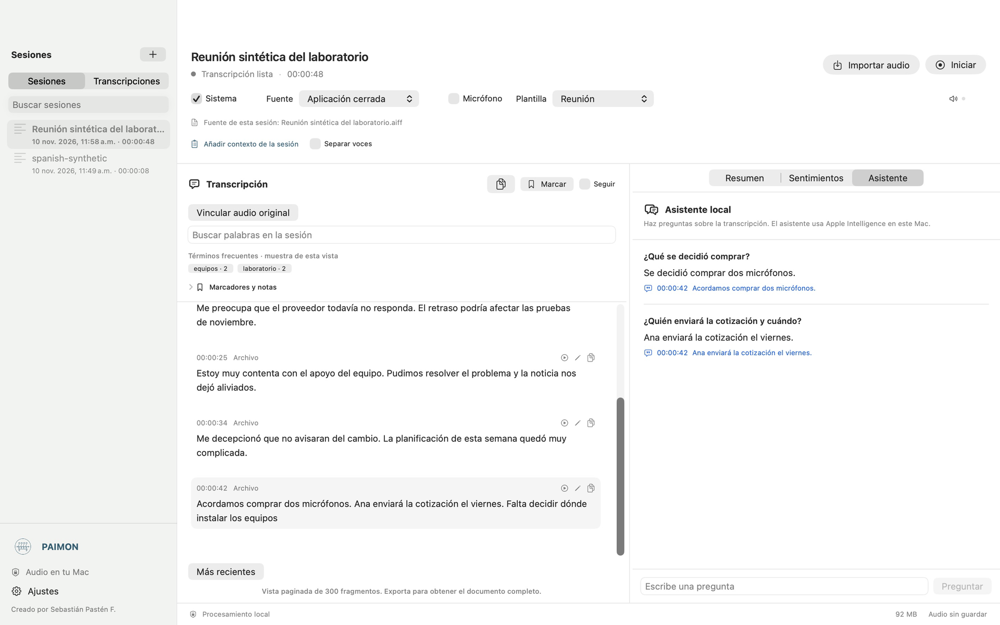
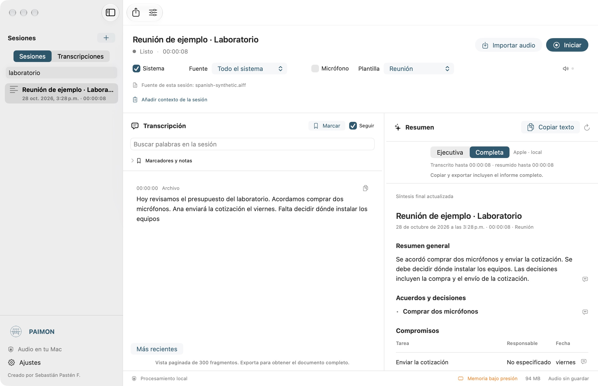
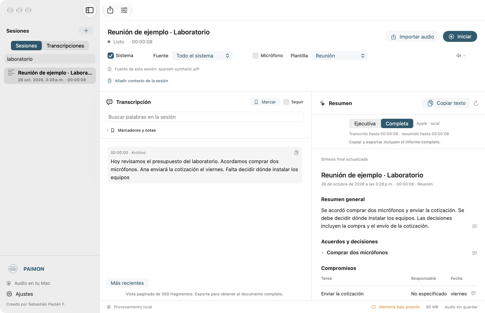
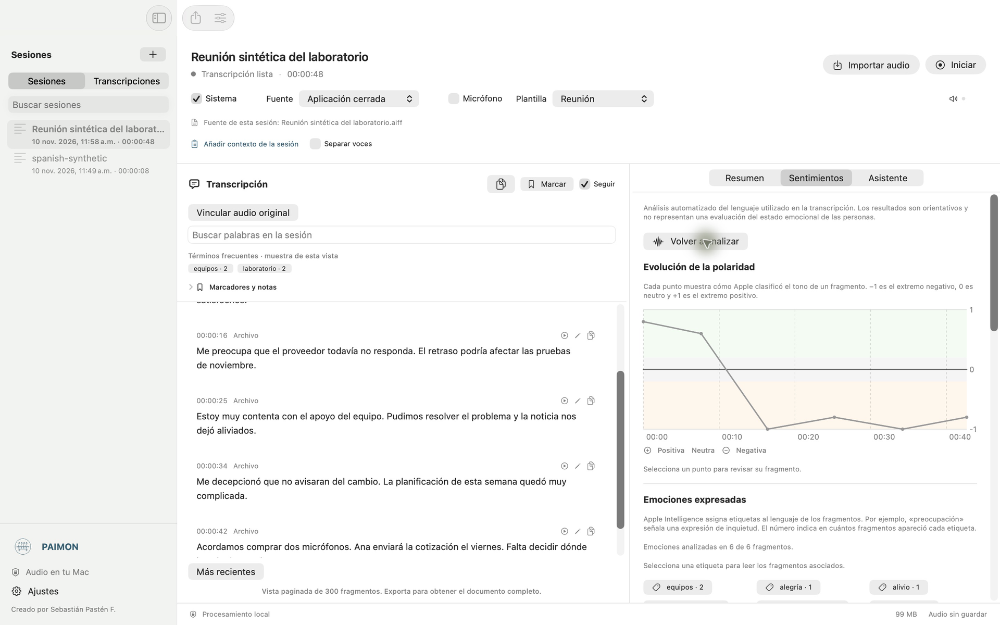
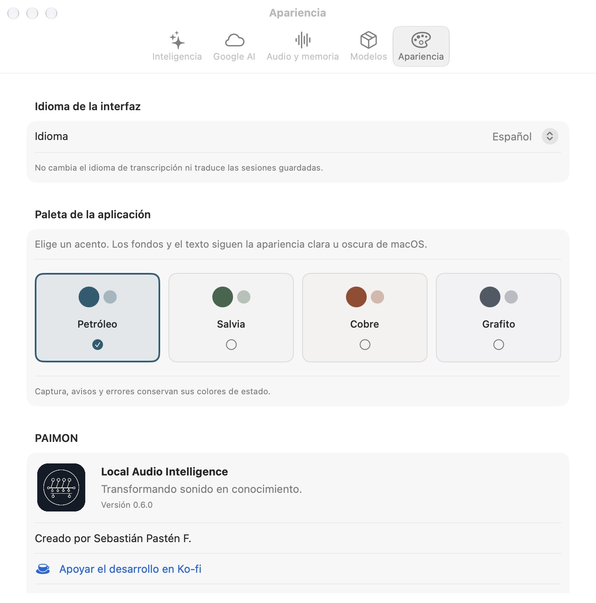

<div align="center">
  
  <h1>PAIMON</h1>
  <p><strong>Del sonido al conocimiento.</strong></p>
  <p>Captura audio, revisa transcripciones y haz preguntas sobre tus sesiones en el Mac.</p>
  <p>
    
    
    
  </p>
  <p><a href="https://github.com/AD0441/PAIMON/releases/tag/v0.9.0">Descargar PAIMON 0.9.0</a> · <a href="#qué-nos-diferencia">Ventajas</a> · <a href="#asistente-local-de-la-transcripción">Asistente</a> · <a href="#descargar-instalar-y-ejecutar">Empezar</a> · <a href="docs/REQUIREMENTS.md">Requisitos</a> · <a href="docs/LIMITATIONS.md">Alcance</a> · <a href="https://ko-fi.com/C0C51WQ1T0">Apoyar</a></p>
</div>


*Composición promocional generada con IA a partir de recursos reales de la app. [Procedencia y capturas originales](docs/assets/promo/photographic-cover.md).*

## Qué nos diferencia

**Del audio que ya suena en tu Mac a respuestas que puedes comprobar.** Pregunta qué se decidió, quién quedó a cargo o cuándo se habló de un tema. Las citas del resumen y del Asistente te llevan al fragmento de la transcripción que respalda la respuesta.

- **Pregunta y sigue conversando.** El Asistente usa Apple Intelligence en el Mac para responder sobre la sesión elegida. Si los fragmentos consultados no respaldan una respuesta, te lo indica. [Ver el Asistente en uso](#asistente-local-de-la-transcripción).
- **Llévate los acuerdos y las tareas.** Revisa decisiones, compromisos y preguntas abiertas con sus citas. Copia el informe con formato o expórtalo en TXT, Markdown, PDF o JSON.
- **Captura lo que ya escuchas.** Graba el audio del sistema o de una aplicación sin instalar dispositivos virtuales. Añade el micrófono cuando lo necesites, controla la captura desde la barra de menús o importa una grabación.
- **Tú decides dónde se procesa.** El flujo local funciona sin cuenta, clave API ni telemetría. Si activas Google AI con tu propia clave, solo el resumen se procesa fuera del Mac. El audio y las preguntas del Asistente se quedan en el equipo. [Cómo funciona la opción de Google AI](#google-ai--resumen-externo-opcional).

## Novedades en PAIMON 0.9.0

- **Asistente local.** Consulta acuerdos, tareas o temas de una sesión y haz preguntas de seguimiento. Apple Intelligence busca respaldo en la transcripción. Las citas llevan al fragmento original.
- **Polaridad más fácil de leer.** El gráfico explica los valores de −1 a +1 y avisa cuando muchos puntajes coinciden en un extremo. Las etiquetas de emoción abren sus citas y los cambios destacados muestran el puntaje anterior y el nuevo.
- **Interfaz en español e inglés.** Las tres pestañas del panel de análisis siguen el idioma elegido en Configuración.

Compilación 24 verificada con 111 pruebas en un M1 de 8 GB, incluida una consulta real con Apple Intelligence y una transcripción sintética. [Resultados reproducibles](docs/VALIDATION.md#asistente-local-de-la-transcripción--paimon-090-24).

## Asistente local de la transcripción

1. Abre una sesión con transcripción y selecciona **Asistente**, junto a **Resumen** y **Sentimientos**.
2. Escribe una pregunta como «¿Qué se decidió comprar?» y pulsa **Preguntar**. Puedes hacer una pregunta de seguimiento.
3. Pulsa una cita con su marca de tiempo para ir al fragmento original. Si los pasajes consultados no respaldan la respuesta, el asistente te lo indica.



*Captura de una reunión sintética. La cita de los 42 segundos destaca el fragmento original.*

El Asistente requiere Apple Intelligence disponible en el Mac. Procesa las preguntas y los fragmentos en el equipo, sin conexión ni clave API, incluso cuando Google AI está seleccionado para resumir. En sesiones largas busca pasajes relevantes y limita cuánto texto consulta. Las preguntas y respuestas se mantienen en memoria mientras la sesión está seleccionada. El Asistente se pausa durante la captura, la importación o la presión de memoria.

## Simplicidad con impacto

**Concéntrate en lo que vale la pena.** Creamos herramientas nativas para Mac que reúnen lo necesario en un flujo claro: menos pasos repetidos, decisiones visibles y control sobre tu trabajo. En PAIMON, eso significa atender a la conversación y después revisar qué se dijo, qué se decidió y de dónde sale cada conclusión.

Compartimos una filosofía y una [identidad visual](docs/FAMILY.md); cada aplicación conserva su propósito, su sello y sus límites.

## De escuchar a entender

| Captura | Revisión | Informe |
| --- | --- | --- |
| Audio del sistema o una aplicación; micrófono opcional | Texto con horas, búsqueda, términos y marcadores | Resumen general, ideas, decisiones, tareas y conclusiones |
| Sin dispositivos virtuales ni silenciar la reproducción | Contexto y plantillas para reunión, clase o podcast | Citas verificables y exportación TXT, Markdown, PDF y JSON |



Las imágenes de revisión usan datos sintéticos y una instancia separada de la instalación del usuario. Las transcripciones originales se conservan independientemente de los resúmenes.

<details>
<summary><strong>Consultar la evidencia de cada conclusión</strong></summary>



</details>

## Sentimientos de la transcripción

Abre **Sentimientos** y pulsa **Analizar sentimientos**. El gráfico muestra los puntajes de Apple por fragmento, sin suavizar. −1 es el extremo negativo, 0 es neutro y +1 es el extremo positivo. Selecciona un punto o un momento destacado para ver la cita y volver al texto original. Cuando faltan tiempos válidos, el gráfico usa el orden de los fragmentos. Si la mayoría de los puntajes coincide en un extremo, la vista indica cuántos fragmentos lo recibieron. Las emociones expresadas son etiquetas para el lenguaje de los fragmentos. Por ejemplo, «preocupación» marca una expresión de inquietud. Pulsa una etiqueta para ver sus citas. Un cambio de polaridad destacado compara los puntajes de dos fragmentos consecutivos cuando la diferencia alcanza 0,55.

El análisis se ejecuta en el Mac. La polaridad depende de los idiomas disponibles en NaturalLanguage. El etiquetado de emociones requiere Apple Intelligence y muestra cuántos fragmentos pudo analizar. En sesiones largas selecciona hasta 48 fragmentos para el etiquetado, entre cambios relevantes y muestras de toda la sesión. Los resultados se guardan en SQLite y se invalidan al editar la transcripción.



## Clave de Google AI cuando la RAM limita el resumen local

Google AI (Gemini) permite trasladar la inferencia del resumen a sus servidores cuando la memoria disponible limita el modelo local, por ejemplo en un M1 con 8 GB. Captura y transcripción continúan en el Mac. No se han medido ahorros de RAM con esta alternativa.

1. En **Configuración → Google AI**, activa la opción y guarda tu clave en el Llavero.
2. Las sesiones existentes conservan su motor. Marca **Usar Google AI para esta sesión** y pulsa **Actualizar resumen** para cambiarlas.
3. Se envían fragmentos de texto, contexto y resúmenes anteriores a Google; nunca el audio. Requiere Internet y utiliza la cuota y facturación de tu proyecto.

No hay cambio automático a la nube. Mientras macOS indica presión de memoria, **todos** los motores de resumen se aplazan, incluido Google. Esta opción no libera RAM por sí sola ni garantiza trabajo bajo presión crítica. Los trabajos finales se conservan para reintentarlos. [Detalles del proveedor y errores transitorios](#google-ai--resumen-externo-opcional).

## Descargar, instalar y ejecutar

1. Descarga el [ZIP de PAIMON 0.9.0](https://github.com/AD0441/PAIMON/releases/download/v0.9.0/PAIMON-0.9.0.zip). Requiere Apple Silicon y macOS 26.0 o posterior. Se probó en un M1 de 8 GB con macOS 27.3. [Historial de versiones](https://github.com/AD0441/PAIMON/releases).
2. Si quieres verificar el ZIP, descarga el [archivo SHA-256](https://github.com/AD0441/PAIMON/releases/download/v0.9.0/PAIMON-0.9.0.zip.sha256) a la misma carpeta y ejecuta `shasum -a 256 -c PAIMON-0.9.0.zip.sha256`.
3. Cierra PAIMON, descomprime y copia **PAIMON.app** a **Aplicaciones**. La firma ad hoc puede impedir abrirla en otros Mac; la firma Developer ID y notarización siguen pendientes.
4. Abre la app y comprueba los recursos de voz y Apple Intelligence en Configuración. Reproduce audio y pulsa **Iniciar**. macOS solicitará el permiso del audio del sistema y, solo si lo activas, del micrófono.

La app está en **/Applications/PAIMON.app** y se abre desde Finder o Spotlight sin Xcode. Actualizar conserva el historial local. En el proyecto, **PAIMON.app** es un enlace a esa instalación. **Versiones/PAIMON-actual.zip** y **Versiones/PAIMON-anterior.zip** conservan la compilación instalada y la anterior.

El instalador verifica la firma y el ZIP extraído antes de sustituir la aplicación; recompilar la misma versión no desplaza el archivo anterior. El enlace evita que File Provider modifique los recursos firmados del bundle. Para llevarla a otro Mac usa el ZIP.

El icono nuevo está en `Resources/Brand/PAIMON-icon.svg` y `.png`; `Resources/Paimon.icns` incluye los tamaños de macOS. Se regenera con `xcrun swift script/render_brand.swift` y `./script/rebuild_icon.sh`. [Referencia y decisiones de marca](docs/BRAND.md). Los iconos anteriores se conservan en el historial de Git; la carpeta de marca contiene únicamente los recursos vigentes.

## Compilar desde el código fuente

1. Abre `LocalAudioIntelligence.xcodeproj` en Xcode 27.2, con SDK macOS 27.2 y Swift 6.4. El target conserva deployment target 26.0 y arquitectura arm64; las APIs nuevas tienen comprobaciones de disponibilidad para ejecutar en macOS 26.
2. Selecciona el esquema **LocalAudioIntelligence**, destino **My Mac**, y ejecuta. Firma local ad hoc; para distribuir usa tu identidad Developer ID.
3. En Configuración → Inteligencia, comprueba el motor. En Modelos puedes **autorizar** la instalación de recursos Speech del idioma elegido. Activa Apple Intelligence en Ajustes del Sistema si el resumen indica que falta el modelo.
4. Reproduce un video o entra en la reunión, selecciona Todo el sistema o una aplicación abierta y pulsa **Iniciar**. Acepta el permiso de grabación de audio del sistema de macOS. Si activas micrófono, autoriza también ese permiso.
5. El panel **Resumen** presenta título, fecha y duración, resumen general, puntos clave, acuerdos, compromisos, preguntas abiertas y conclusiones. Las secciones sin contenido se omiten. El icono de cita al final de cada punto abre su evidencia y permite ir al fragmento original. **Copiar texto** conserva encabezados, negritas y la tabla de tareas para Word o Pages. Los resultados definitivos se guardan de inmediato. El resumen se actualiza cada cinco minutos por defecto. **Detener** finaliza el reconocimiento y sintetiza lo pendiente. Cierra la ventana para continuar desde la barra de menús.

La exportación PDF mantiene la jerarquía tipográfica y las tablas; Markdown conserva encabezados y negritas. **Anexo de evidencias** añade las citas al final, con enlaces internos desde PDF y Markdown. TXT usa texto plano con la misma estructura. JSON conserva los hallazgos y sus referencias estructuradas. Cuando una tarea carece de responsable o fecha, se muestra **No especificado**.

La síntesis de Apple exige un **Resumen general** antes de marcarse como final. Los resúmenes anteriores a la versión 0.3.2 se reconstruyen desde la transcripción al pulsar **Actualizar resumen**; no basta con volver a condensar un resultado antiguo incompleto. El menú contextual de ese botón ofrece **Rehacer desde la transcripción**. Un mismo icono de evidencia puede abrir varios fragmentos cuando el resumen integra distintos momentos. Si el modelo devuelve un resultado insuficiente, se informa del fallo y se conserva la transcripción.

## Motores locales opcionales

En **Ajustes → Modelos**, cada motor opcional tiene una explicación, una casilla y los botones **Descargar modelos** y **Borrar modelos**. PAIMON verifica los archivos, prepara los recursos y selecciona su carpeta automáticamente.

- **FluidAudio con Parakeet Redux** transcribe audio multilingüe en el Mac. Requiere aproximadamente 220 MB.
- **MLX con Qwen 1.5B** resume la transcripción usando la GPU del Mac. Usa cerca de 1,4 GB de disco con su entorno local incluido.

Si preparaste un entorno MLX propio, las rutas están en **Instalación manual…**. Tras la descarga, los motores trabajan sin Internet. Los recursos de Apple siguen bajo gestión de macOS. [Detalles de los modelos y del entorno](docs/DEPENDENCIES.md).

## Separar voces · opcional

**Separar voces** se activa antes de iniciar la captura o de importar audio. Las etiquetas aparecen junto al fragmento cuando el motor encuentra un hablante predominante. Pulsa **Hablante 1**, **Hablante 2** u otra etiqueta para poner un nombre que se conserva en esa sesión. El audio de sistema y micrófono mantiene sus propias etiquetas.

En **Ajustes → Modelos**, pulsa **Descargar modelos** (unos 14 MB) y activa la casilla **Separar voces**. La descarga se verifica y se selecciona automáticamente. **Borrar modelos** libera ese espacio y apaga la opción. [Detalles del motor y de los modelos](docs/DEPENDENCIES.md#diarización-local-opcional).

## Marcadores, búsqueda y plantillas

- **Marcar** o **⌘⇧M** guarda el momento actual. También puedes marcar un fragmento desde su menú contextual. En **Marcadores y notas**, escribe una anotación y pulsa **Guardar** o Intro; pulsa su hora para volver al texto. La barra de menús permite marcar la captura en curso. Las notas se guardan por separado y no se envían al modelo.
- **⌘⇧F** abre la búsqueda en todas las transcripciones. Escribe dos caracteres o más y abre un resultado para ir a la sesión y al fragmento correspondiente. Tolera mayúsculas y acentos; varias palabras deben coincidir en el mismo fragmento. Muestra hasta 50 resultados. El historial anterior se indexa por lotes cuando no hay captura ni presión de memoria.
- El selector **Plantilla** ofrece **Reunión**, **Clase** y **Video o podcast**. Cambia el énfasis del resumen usando el proveedor seleccionado para la sesión. Se elige antes de iniciar; para aplicarla a una sesión guardada, cambia la plantilla y pulsa **Actualizar resumen**. Esta acción vuelve a procesar el contenido original; las actualizaciones normales siguen siendo incrementales. Configuración permite fijar la plantilla predeterminada.

La exportación incluye una opción **Marcadores y notas**, con horas y anotaciones en TXT, Markdown, PDF y JSON. Las negritas y las tablas del informe se mantienen en los formatos que las admiten. Estas funciones no añaden modelos, descargas ni consultas de IA por cada búsqueda o marcador.

Usa audífonos con sistema + micrófono para evitar la captación acústica de los altavoces. No se reproduce ni monitoriza la entrada de micrófono.

```bash
./script/build_and_run.sh           # compilar y abrir
./script/build_and_run.sh --verify  # comprobar proceso
./script/build_and_run.sh --debug
./script/build_and_run.sh --install # actualizar la app del proyecto y de Aplicaciones
./script/test.sh
```

El script selecciona Xcode mediante `DEVELOPER_DIR` sin modificar la configuración global. DerivedData y los binarios de pruebas se crean en el directorio temporal del usuario: el proyecto está dentro de una ubicación administrada por File Provider, que puede añadir FinderInfo e impedir la firma si se compila allí.

También existe un paquete Swift reproducible, sin dependencias de terceros en el producto principal. `swift build` compila biblioteca, interfaz y diagnóstico. Usa una `.app` para ejecutar la interfaz y sus permisos; no ejecutes su binario SwiftPM directamente.

## Preparar, importar y revisar sesiones

- **Añadir / Editar contexto de la sesión** abre un editor separado para objetivo, temario y glosario, sin cambiar la distribución de la ventana principal. Se limita a 250, 600 y 350 caracteres. Sirve como orientación; las afirmaciones, nombres, fechas y acuerdos siguen necesitando evidencia original. Cambiar el contexto de una sesión guardada requiere **Actualizar resumen**; el historial del original se conserva.
- **Iniciar** muestra cuándo PAIMON comprueba los recursos de voz, el micrófono y el audio del sistema. Si faltan permisos, puedes abrir Ajustes del Sistema desde la app.
- **Importar audio**, **⌘O** o arrastrar un archivo abre una grabación compatible con AVAudioFile, como AIFF, WAV, M4A o MP3. Se lee por bloques y se transcribe con los mismos motores locales. Apple aplica contrapresión para no llenar la cola; la importación puede avanzar más rápido que la reproducción, según el equipo y el motor. No se duplica ni guarda el audio importado. **Cancelar importación** conserva los fragmentos definitivos ya reconocidos. Captura e importación se realizan de una en una.
- En **Configuración → Audio y memoria → Audio importado**, puedes activar **Normalizar volumen y comprimir picos**. El ajuste nivela por bloques la señal que recibe el transcriptor, preserva sus tiempos y conserva el archivo original. Parte desactivado.
- El panel Resumen muestra hasta dónde se ha guardado texto, hasta dónde se ha resumido y cuántos fragmentos quedan pendientes. Durante la generación se actualiza cada dos segundos. Un final aplazado por recursos sigue pendiente de recuperación.
- **Ejecutiva / Completa / Acuerdos y pendientes** cambia la presentación usando los hallazgos guardados. **Acuerdos y pendientes** reúne decisiones, compromisos y preguntas abiertas con sus citas en páginas propias. No genera de nuevo ni carga modelos. Copiar y exportar conservan el informe completo con su formato y evidencia.
- **Revisa y escucha los fragmentos.** Corrige el texto reconocido o restaura el original sin cambiar los tiempos. Copiar, buscar y exportar usan el texto revisado. Si el archivo importado sigue disponible, puedes escuchar el intervalo citado.
- **Eliminar una sesión** retira su audio archivado y sus transcripciones, resúmenes, notas e índices locales.
- Los **términos frecuentes** se calculan sin IA sobre una muestra de los fragmentos de la vista: hasta 300 fragmentos y 100.000 caracteres. Pulsarlos busca en esa sesión, sin distinguir acentos o mayúsculas. La frecuencia no equivale a importancia semántica ni representa necesariamente toda la grabación.

## Google AI · resumen externo opcional

Esta alternativa permite evitar la inferencia local del resumen cuando la memoria del equipo limita su uso. Se selecciona expresamente por el usuario; no se activa automáticamente ante presión de RAM. El control de presión de memoria sigue vigente para todos los motores y puede aplazar la generación hasta que el sistema se recupere.

1. En **Configuración → Google AI**, activa **Usar Google AI para resumir nuevas sesiones**. Las sesiones anteriores conservan su motor; en su panel Resumen puedes marcar **Usar Google AI para esta sesión** y pulsar **Actualizar resumen**.
2. Obtén tu propia clave en [Google AI Studio](https://aistudio.google.com/apikey), introdúcela en el campo seguro y pulsa **Guardar en el Llavero**. No la escribas en archivos del proyecto. Puedes eliminarla desde la misma pantalla.
3. Configura el identificador del modelo, inicialmente `gemini-3.8-flash`, y usa **Probar conexión**. Esta acción consulta el modelo; no envía ninguna transcripción. **Aplicar a la sesión seleccionada** permite cambiar su modelo antes de actualizar el resumen.

Gemini recibe fragmentos de texto, contexto y resúmenes previos, mediante HTTPS al endpoint oficial de Google. Nunca recibe audio. La respuesta JSON se valida con los mismos controles de citas y acuerdos que el motor nativo. Se conservan las actualizaciones por lotes y la síntesis jerárquica; no se envía toda la transcripción en cada actualización. Cambiar de motor, modelo o contexto reconstruye el resumen desde el original para evitar mezclar cursores incompatibles.

La clave permanece en el Llavero local, fuera de SQLite, preferencias, exportaciones y Git. Desactivar Google AI cancela la solicitud en curso y vuelve al motor local. Los errores de conexión, cuota, permisos, respuesta truncada o bloqueo se muestran sin perder la transcripción. Los fallos temporales HTTP 500/502/503/504 admiten hasta dos reintentos con espera exponencial, variación aleatoria y respeto de Retry-After hasta 30 s. Una espera mayor se deja para el usuario; no se reintentan automáticamente errores de clave, cuota ni solicitudes de red con resultado incierto. Esta modalidad requiere Internet y está sujeta a la cuota, facturación y tratamiento de datos de tu proyecto Google; el funcionamiento local sigue disponible sin clave.

## Motores opcionales

FluidAudio/Parakeet Redux y MLX se ejecutan mediante procesos locales y un protocolo JSON por pipes. No se instalan al abrir la aplicación. Consulta [dependencias](docs/DEPENDENCIES.md). Los modelos opcionales se cargan por demanda y se liberan al finalizar una inferencia. Una compuerta compartida limita las inferencias pesadas; el audio sigue capturándose con colas acotadas.

Apple SpeechTranscriber en macOS 26 requiere seleccionar español o inglés. Parakeet multilingüe detecta automáticamente el idioma. La opción «Automático» elige Apple si está preparado y, de lo contrario, FluidAudio si se ha configurado.

## Pruebas y estado

La [lista de requisitos y estado](docs/REQUIREMENTS.md) consolida las decisiones del producto, las mejoras realizadas y los casos de aceptación pendientes.

Consulta [resultados verificables](docs/VALIDATION.md), [arquitectura y privacidad](docs/ARCHITECTURE.md), [optimización y mediciones](docs/PERFORMANCE.md) y [limitaciones](docs/LIMITATIONS.md). La aplicación nunca sustituye la captura, la transcripción ni el resumen por datos de demostración. Los dobles de motor existen en las pruebas y en el diagnóstico explícito de cargas sintéticas; la aplicación usa siempre los motores reales.

El historial conserva todos los fragmentos definitivos. La interfaz pagina 300 fragmentos, 50 sesiones y 120 hallazgos. La memoria narrativa del modelo conserva hasta 80 elementos; un registro independiente en SQLite conserva los acuerdos, tareas, conceptos y demás hallazgos extraídos, aunque salgan de esa memoria. Copiar incluye el registro completo, con formato; las exportaciones lo recorren por páginas y mantienen las citas enlazadas en un anexo final. Cada afirmación aceptada incluye texto original y marcas temporales. Una cita válida no garantiza por sí sola que la interpretación sea correcta.

En **0.4.0 (10)**, detener espera la actualización en curso y procesa el texto final pendiente. Los finales pospuestos por memoria o un error quedan registrados para recuperarse cuando baje la presión de memoria, al reabrir la app o mediante Actualizar resumen. Los resúmenes automáticos usan el intervalo elegido y el volumen de texto: pueden adelantarse después de un minuto si se acumulan al menos 6.000 bytes; no se genera por silencio. Los parciales y medidores se presentan cada 300 ms, sin retrasar el guardado del texto definitivo. La duración se fija antes de cerrar los dispositivos para excluir las esperas de Core Audio.

El procesamiento Apple v3 exige que la frase que expresa un acuerdo respalde ese punto concreto: «Falta decidir dónde instalar los equipos» no puede convertirse en decisión por compartir un fragmento con «Acordamos comprar dos micrófonos». **Actualizar resumen** reconstruye los resultados de versiones anteriores desde la transcripción. Es una comprobación conservadora; conserva la evidencia para revisión humana.

## Apariencia y apoyo

En **Configuración → Apariencia** puedes elegir Petróleo, Salvia, Cobre o Grafito. La paleta cambia los acentos de la interfaz sin cargar modelos, imágenes remotas ni animaciones continuas. El modo claro u oscuro sigue macOS.



**Creado por Sebastián Pastén F.**

[](https://ko-fi.com/C0C51WQ1T0)

El apoyo es voluntario. La app abre Ko-fi únicamente al pulsar el enlace; no carga recursos de donación desde Internet al iniciar.

<div align="center">
  <p><strong>Simplicidad con impacto.</strong><br>Concéntrate en lo que vale la pena.</p>
  <p><a href="https://github.com/AD0441/NABERIUS">NABERIUS</a> · <a href="https://github.com/AD0441/RAZIEL">RAZIEL</a> · <a href="https://github.com/AD0441/METATRON">METATRON</a> · <a href="https://github.com/AD0441/PAIMON">PAIMON</a> · <a href="https://github.com/AD0441/VAPULA">VAPULA</a></p>
  <p><strong>Creado por Sebastián Pastén F.</strong></p>
  <p><a href="https://www.sebastianpasten.com/desarrollos-aplicaciones-para-mac-software-sdr">Más aplicaciones para Mac</a> · <a href="https://ko-fi.com/C0C51WQ1T0">Apoyar en Ko-fi</a></p>
</div>
